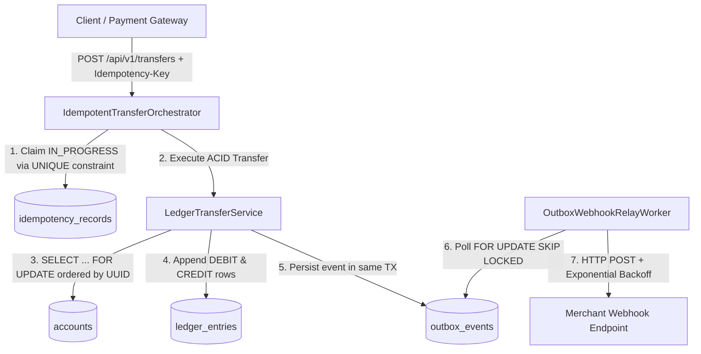

# Idempotent Payment & Double-Entry Ledger Engine

A fault-tolerant FinTech payment and ledger microservice built with **Java 21**, **Spring Boot**, **PostgreSQL**, and **Flyway**. Designed to prevent duplicate charges during network retries, eliminate race conditions under high concurrency, and guarantee reliable asynchronous webhook delivery.

## Architecture Overview



## Core Engineering Guarantees

1. **Idempotency Middleware (`Idempotency-Key` Header)**
    - Enforces a PostgreSQL `UNIQUE` constraint on `idempotency_key` combined with SHA-256 request payload fingerprinting.
    - Replays cached responses (`replayed: true`) for identical retries, returns `409 Conflict` for in-flight duplicate bursts or payload mismatches, and guarantees **0 duplicate charges**.
2. **Double-Entry Ledger & Deadlock-Free Pessimistic Locking**
    - Every transfer atomically records balanced `DEBIT` and `CREDIT` rows inside an immutable append-only `ledger_entries` table.
    - Acquires row-level `PESSIMISTIC_WRITE` (`SELECT ... FOR UPDATE`) locks sorted deterministically by `account.id ASC`, preventing negative balances and eliminating bidirectional transfer deadlocks (`A -> B` vs `B -> A`).
3. **Transactional Outbox Pattern + Exponential Backoff**
    - Saves webhook events inside the **exact same database transaction** as the balance mutation—eliminating the dual-write problem.
    - A scheduled relay worker claims batches using `FOR UPDATE SKIP LOCKED` (safe for horizontal multi-instance scaling) and retries transient failures with exponential backoff (`2s -> 4s -> 8s -> 16s -> 32s`).

## Quick Start (Docker Compose)

```bash
docker compose up --build -d
```

- **Swagger UI:** http://localhost:8080/swagger-ui.html
- **Health Check:** http://localhost:8080/actuator/health

## Sample API Workflow

### 1. Create Two Accounts
```bash
curl -X POST http://localhost:8080/api/v1/accounts \
  -H "Content-Type: application/json" \
  -d '{"ownerName": "Alice", "currency": "USD", "initialBalance": 1000.00}'

curl -X POST http://localhost:8080/api/v1/accounts \
  -H "Content-Type: application/json" \
  -d '{"ownerName": "Bob", "currency": "USD", "initialBalance": 500.00}'
```

### 2. Execute an Idempotent Transfer
```bash
curl -X POST http://localhost:8080/api/v1/transfers \
  -H "Content-Type: application/json" \
  -H "Idempotency-Key: tx-2026-0001" \
  -d '{
    "fromAccountId": "<ALICE_UUID>",
    "toAccountId": "<BOB_UUID>",
    "amount": 150.00,
    "webhookUrl": "[https://webhook.site/your-endpoint](https://webhook.site/your-endpoint)"
  }'
```
*(Re-running the exact command above returns the original `transferId` with `"replayed": true` without debiting Alice twice.)*

## Concurrency & Integration Test Suite

Run the Testcontainers + JUnit 5 stress suite (requires Docker):

```bash
./mvnw test
```

Includes multi-threaded verification (`ExecutorService` + `CountDownLatch`) proving:
- **100 parallel identical retries** result in **1** transfer and **1** ledger debit.
- **100 parallel distinct transfers** against a `$100` balance allow **6** `$15` transfers and reject **94** with `InsufficientFundsException` (balance stops at `$10.00`, never negative).
- **40 simultaneous bidirectional transfers** (`Alice <-> Bob`) complete with zero deadlocks.